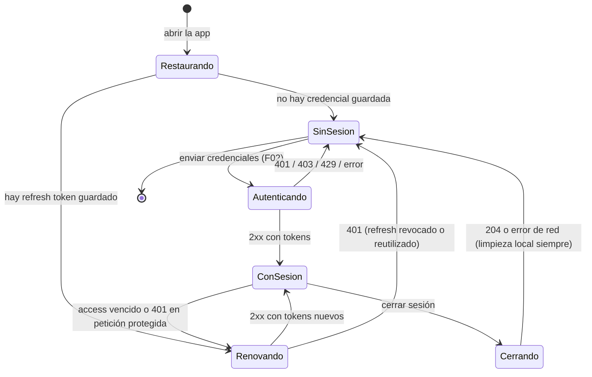

# ARQM-003 — Sesión, estado y datos del cliente

**Versión:** 0.1.0 | **Estado:** Propuesto — requiere aprobación | **Depende de:** `../../../constitution.md` (CM-07, CM-13), `ARQM-001`, `ARQM-002`, ADR-M002 | **Amplía:** ARM-006, ARM-007, ARM-013 | **Contraparte backend:** `EP-M01-04`, `EP-M01-05`, `EP-M01-08` (Propuesto, backend).

## Propósito
Definir cómo vive la sesión en el dispositivo, qué datos se conservan y cómo se tratan los estados de carga. Es política general: no depende de ninguna pantalla.

## Máquina de estados de sesión

## Requisitos

| ID | Requisito (DEBE) | Norma / amenaza |
|---|---|---|
| MV-A03-R01 | La sesión del cliente se modela con los estados `Restaurando`, `SinSesion`, `Autenticando`, `ConSesion`, `Renovando` y `Cerrando`, con las transiciones del diagrama; ninguna pantalla decide el estado por su cuenta | CM-13 |
| MV-A03-R02 | Al abrir la app, si existe credencial guardada se intenta **renovar** una sola vez antes de mostrar contenido protegido; si falla con 401 se pasa a `SinSesion` sin mostrar datos | CM-13, THM-11 |
| MV-A03-R03 | Hay **a lo sumo una renovación en vuelo**: las peticiones que reciben 401 mientras se renueva esperan el resultado y se reintentan **una sola vez**; un segundo 401 lleva a `SinSesion` | THM-11 |
| MV-A03-R04 | El cliente usa `expiraEn` (UTC) del servidor como única fuente de vigencia del access token, con un margen de anticipación **por definir tras medición**; no codifica duraciones | ALN-08 |
| MV-A03-R05 | El token renovado **reemplaza de forma atómica** al anterior en el almacenamiento seguro; un refresh ya rotado nunca se vuelve a enviar | THM-11 |
| MV-A03-R06 | Cerrar sesión **siempre** limpia en el dispositivo credenciales, caché de consultas, estado de sesión y token de notificaciones, aunque el servidor no responda; además intenta notificar al servidor (`EP-M01-05`). Cierra solo el dispositivo actual | Lineamiento 10, CM-07 |
| MV-A03-R07 | Un 401 irrecuperable (refresh revocado, cuenta eliminada o suspendida) produce el mismo cierre local con un mensaje neutro; no se reintenta en bucle | CM-13 |
| MV-A03-R08 | Los datos se clasifican y almacenan según la tabla de abajo; ninguna clase puede persistirse en un lugar menos protegido que el indicado | CM-07 |
| MV-A03-R09 | Los datos de formularios (contraseñas, códigos) viven solo en memoria durante la pantalla; no se restauran tras cerrar la app | THM-05 |
| MV-A03-R10 | La caché de consultas tiene vigencia por recurso, se invalida por tiempo o por evento y **se vacía al cerrar sesión**; no sustituye al servidor ni habilita modo offline | Lineamiento 9, CM-13 |
| MV-A03-R11 | Los estados de carga usan un vocabulario único: `inactivo`, `cargando`, `exito`, `vacio`, `error`, `sinConexion`, `noAutorizado`, `prohibido`, `limiteDeUso`, `noEncontrado` | CM-13, ARQM-004 |
| MV-A03-R12 | Al volver del segundo plano se revalida la sesión (vigencia de `expiraEn`) antes de mostrar datos sensibles | CM-13 |

## Clases de datos locales

| Clase | Ejemplos | Almacenamiento | Vigencia / borrado |
|---|---|---|---|
| Secreto de sesión | refresh token (y access token si ADR-M002 lo persiste) | **Solo** almacenamiento seguro del sistema | Hasta cerrar sesión, 401 irrecuperable o eliminación de cuenta |
| Token en memoria | access token | Memoria del proceso | Se descarta al cerrar la app o al cerrar sesión |
| Datos del servidor en caché | respuestas de consulta no sensibles | Caché del cliente con expiración | Por recurso; se vacía al cerrar sesión |
| Preferencias no sensibles | ajustes de la app | Almacenamiento local simple | Sin datos personales |
| Datos de formulario | contraseña, código de 6 dígitos | Memoria de la pantalla | Se vacían al enviar con éxito o salir |
| Datos personales de dominio | nombre, correo, fecha de nacimiento | **No se persisten** salvo necesidad aprobada y protegida | Excepción conforme a CM-12 |

## Exclusiones
Sin modo offline ni almacenamiento relacional local (MM-008). La elección de bibliotecas queda en ADR-M002/M003.

## Referencias a pruebas
`tests/unitarias/UT-ARQM.md`, `tests/seguridad/ST-transversal-movil.md`.
