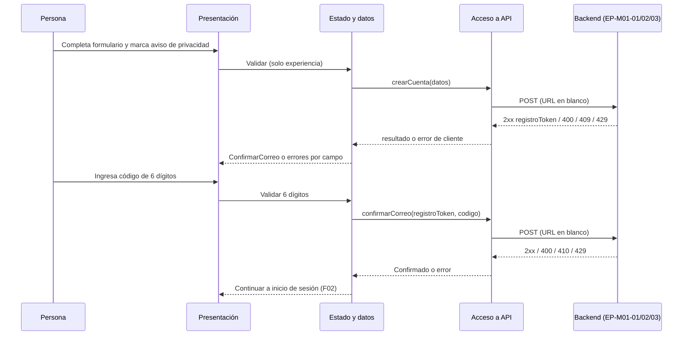

# Plan — F01 Registro de usuario (cliente móvil)

**Estado:** Propuesto — requiere aprobación | **Spec:** [spec.md](spec.md) | **Bloqueos:** DEC-09, DEC-10 (backend), DEC-M05, DEC-M10, ALN-01 (G-M07), ADR-M001/M003.

## Enfoque por capas (sin elegir bibliotecas no aprobadas)

| Capa | Responsabilidad en F01 | Requisitos |
|---|---|---|
| Presentación | Formulario, aviso de privacidad desplegable, pantalla de confirmación, estados y mensajes del catálogo | MV-F01-R01…R06, R11, R12 |
| Estado y datos | Esquema de validación del formulario, estado de flujo (`Formulario → Enviando → ConfirmarCorreo → Confirmando → Confirmado`), cuenta regresiva de reenvío; todo en memoria | MV-F01-R04, R07, R10 |
| Acceso a API | Tres operaciones tipadas (crear cuenta, confirmar, reenviar) que devuelven errores del cliente según `ARQM-004` | MV-F01-R08, R14 |
| Servicios de plataforma | Selector de fecha y autocompletado del sistema; sin almacenamiento persistente de datos del formulario | MV-F01-R10 |

## Secuencia

## Orden de implementación propuesto (cuando se autorice)
1. Pruebas unitarias de validadores y del catálogo de mensajes (`UT-F01-001…009`).
2. Capa de acceso a API contra un simulador fiel al contrato (`IT-F01-001…010`).
3. Flujo de estados del formulario y de la confirmación.
4. Pruebas de seguridad (`ST-F01-001…006`) antes de integrar con el backend real.
5. Integración con el backend **solo cuando** se cierre G-M07 (URLs, DTOs, DEC-09/10).

## Seguridad específica
Ver MV-F01-R10 y R14. El `registroToken` no se persiste; la contraseña no sale del estado de la pantalla; el aviso de privacidad se muestra completo con versión visible; los mensajes son idénticos para casos que el servidor no distingue.

## Dependencias cruzadas
F02 (destino del flujo), M01 del backend, `ARQM-002/003/004/005`, catálogo de textos de la maqueta, landing (URL pública del aviso: valor de ambiente en blanco).

## Criterio de salida
Todos los escenarios Gherkin con evidencia real, G-M07 cerrada y decisiones bloqueantes resueltas. Estado en esta entrega: **Propuesto, sin implementación**.
