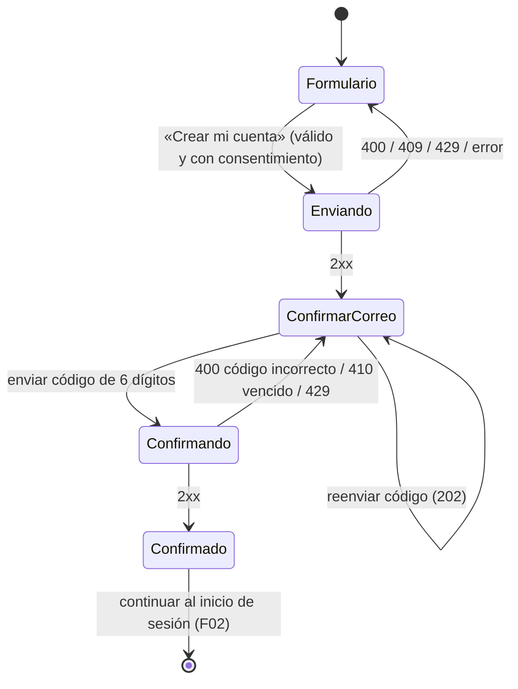

# F01 — Registro de usuario (cliente móvil)

**Versión:** 0.1.0 | **Estado:** Propuesto — requiere aprobación | **Origen:** backend `M01 Identidad, autenticación y cuenta` | **HU:** HU-001, HU-003, HU-012 | **Endpoints del backend:** `EP-M01-01`, `EP-M01-02`, `EP-M01-03` (Propuesto, backend) | **Dependencias:** `ARQM-002`, `ARQM-003`, `ARQM-004`, `ARQM-005` | **Bloqueos:** DEC-09 y DEC-10 (backend), DEC-M05, DEC-M10, ALN-01 · **Siguiente funcionalidad:** F02 (inicio de sesión).

> **Regla de este documento (CM-16):** las columnas **URL** están **en blanco a propósito**; el equipo las completará después. Los JSON usan valores **ficticios** (correo `.invalid`, contraseñas como marcador). Todo DTO que el backend no define está marcado **Propuesto — por acordar**.

## Contexto y resultado observable
Una persona sin cuenta crea una **cuenta única** (sin elegir rol), acepta el aviso de privacidad y confirma su correo con un código de 6 dígitos. Al terminar queda con una cuenta confirmada lista para iniciar sesión (F02).

## HU vinculadas (texto literal del backend)

| HU | Sprint | RF | Texto |
|---|---|---|---|
| HU-001 | Sprint 1 | RF-01 | Registrarme con una sola cuenta indicando mi nombre, correo electrónico, fecha de nacimiento, género, contraseña y confirmación de contraseña, sin elegir un rol |
| HU-003 | Sprint 1 | RF-01 | Confirmar mi correo con un código de 6 dígitos que recibo al crear mi cuenta, con opción de reenviarlo |
| HU-012 | Sprint 1 | RF-05 | Aceptar el aviso de privacidad al registrarme |

## Alcance
**Incluye:** formulario de registro; aviso de privacidad desplegable y consentimiento; envío; pantalla «Confirma tu correo» con código de 6 dígitos y reenvío; paso final hacia el inicio de sesión.
**No incluye:** inicio de sesión (F02); recuperación de contraseña (HU-006), cierre de sesión (HU-005), eliminación de cuenta (HU-096) y perfil (M02): sin spec autorizada aún. Diseño visual: lo define la maqueta.

## Flujo (comportamiento)



## Campos del formulario y validaciones del cliente (solo de experiencia)

| Campo (UI) | Campo del contrato | Tipo | Oblig. | Validación del cliente | Teclado / autocompletado |
|---|---|---|---|---|---|
| Nombre completo | `nombreCompleto` | texto | Sí | 2–120 caracteres tras recortar espacios | Nombre completo |
| Correo electrónico | `correo` | texto | Sí | Formato de correo; se envía en minúsculas | Correo |
| Fecha de nacimiento (día, mes, año) | `fechaNacimiento` | fecha `AAAA-MM-DD` | Sí | Fecha válida y **pasada**; **sin edad mínima** (HU-001) | Selector de fecha |
| Género | `genero` | enum `Mujer` \| `Hombre` \| `PrefiereNoDecir` | Sí | Una de las tres opciones | Selección |
| Contraseña | `contrasena` | texto | Sí | Mínimo 8 caracteres; oculta, con mostrar/ocultar | Contraseña nueva |
| Confirmar contraseña | `confirmarContrasena` | texto | Sí | Igual a `contrasena` | Contraseña nueva |
| Aviso de privacidad (casilla) | `aceptoAvisoPrivacidad` | booleano | Sí | Debe estar marcada; mientras no, «Crear mi cuenta» **no se habilita** (HU-012) | Casilla |
| (sin campo visible) | `versionAvisoPrivacidad` | texto | Sí | Versión del aviso **mostrado** al momento de aceptar | — |
| Código de confirmación | `codigo` | texto | Sí | Exactamente 6 dígitos | Un solo uso / numérico |

El cliente **no pide teléfono**, rol ni otros datos que el contrato no define (CM-07, MV-A02-R15).

## Contrato con el backend

### F01-C1 · Crear cuenta — `EP-M01-01` (HU-001, HU-012)

| Campo | Contenido |
|---|---|
| Método | `POST` |
| **URL** | **`                                                  `** *(en blanco — completar)* |
| Autenticación | Público |
| Reintentos del cliente | **Ninguno automático** (crea cuenta); acción deshabilitada mientras está pendiente |
| Estado del contrato | Solicitud: **Propuesto (backend)**; respuesta: **Propuesto — por acordar** (ALN-01) |

**Solicitud (JSON de ejemplo, valores ficticios):**
```json
{
  "nombreCompleto": "Persona de Ejemplo",
  "correo": "persona@ejemplo.invalid",
  "fechaNacimiento": "2004-05-17",
  "genero": "PrefiereNoDecir",
  "contrasena": "<contraseña de al menos 8 caracteres>",
  "confirmarContrasena": "<igual a contrasena>",
  "aceptoAvisoPrivacidad": true,
  "versionAvisoPrivacidad": "<versión vigente del aviso mostrado>"
}
```

**Respuesta exitosa (JSON propuesto — por acordar; el backend nombra `RegistroResponse` sin campos):**
```json
{
  "registroToken": "<token opaco de la sesión de registro>",
  "codigoExpiraEn": "2026-01-01T00:10:00Z"
}
```
*Estado HTTP esperado: 2xx (201 propuesto). Si se adopta la opción A de DEC-09, la respuesta es la **misma** exista o no el correo.*

**Errores (`ProblemDetails`, regla de `ARQ-005`):**

| HTTP | Caso | JSON de ejemplo | Estado de interfaz |
|---|---|---|---|
| 400 | Datos inválidos | `{"type":"<tipo>","title":"Datos inválidos","status":400,"traceId":"<id>","errors":{"correo":["<mensaje>"],"contrasena":["<mensaje>"]}}` | `error` con mensajes por campo |
| 409 | Correo ya registrado **(solo si DEC-09 = B)** | `{"type":"<tipo>","title":"<título>","status":409,"traceId":"<id>"}` | `error` en el campo correo |
| 429 | Límite de uso | `{"type":"<tipo>","title":"<título>","status":429,"traceId":"<id>"}` + `Retry-After` si existe | `limiteDeUso` |
| 5xx / red | Fallo | `{"type":"<tipo>","title":"<título>","status":500,"traceId":"<id>"}` | `error` / `sinConexion` |

### F01-C2 · Confirmar correo — `EP-M01-02` (HU-003)

| Campo | Contenido |
|---|---|
| Método | `POST` |
| **URL** | **`                                                  `** *(en blanco — completar)* |
| Autenticación | Público con **token de sesión de registro** (transporte por acordar: cuerpo o cabecera; se muestra en el cuerpo como propuesta) |
| Reintentos del cliente | Ninguno automático; máximo de intentos lo decide el servidor |
| Estado del contrato | Solicitud: `codigo` **Propuesto (backend)**, `registroToken` **por acordar**; respuesta: **por acordar** (ALN-01) |

**Solicitud (JSON de ejemplo):**
```json
{
  "registroToken": "<token opaco de la sesión de registro>",
  "codigo": "<6 dígitos>"
}
```

**Respuesta exitosa (JSON propuesto — por acordar; el backend nombra `ConfirmarCorreoResponse` sin campos):**
```json
{
  "confirmado": true
}
```

| HTTP | Caso | Estado de interfaz |
|---|---|---|
| 400 | Código incorrecto (`errors.codigo`) | `error` bajo el campo; permite corregir y reenviar |
| 410 | Código vencido (más de 10 min) | `error`; ofrece «Reenviar código» |
| 429 | Demasiados intentos | `limiteDeUso` |
| 5xx / red | Fallo | `error` / `sinConexion` |

### F01-C3 · Reenviar código — `EP-M01-03` (HU-003)

| Campo | Contenido |
|---|---|
| Método | `POST` |
| **URL** | **`                                                  `** *(en blanco — completar)* |
| Autenticación | Público con token de sesión de registro |
| Estado del contrato | Respuesta `202` sin cuerpo: **Propuesto (backend)**; `ReenviarCodigoRequest` sin campos definidos → **por acordar** |

**Solicitud (JSON propuesto — por acordar):**
```json
{
  "registroToken": "<token opaco de la sesión de registro>"
}
```
**Respuesta:** `202` sin cuerpo. **Errores:** `429` límite de reenvío → `limiteDeUso` (se muestra espera con `Retry-After` si existe).

## Mensajes (claves del catálogo, textos finales los fija la maqueta)
`registro.error.nombre`, `registro.error.correo`, `registro.error.fecha`, `registro.error.contrasena`, `registro.error.coincidencia`, `registro.error.consentimiento`, `registro.correoDuplicado` *(solo DEC-09 = B)*, `registro.aviso.generico` *(solo DEC-09 = A)*, `confirmar.titulo` («Confirma tu correo»), `confirmar.error.codigo`, `confirmar.error.vencido`, `confirmar.reenviar`, `comun.sinConexion`, `comun.limiteDeUso`.

## Reglas de negocio específicas del cliente

| ID | Requisito (DEBE) | Origen |
|---|---|---|
| MV-F01-R01 | El formulario solicita exactamente los campos de la tabla y **no pide elegir** entre estudiante o arrendador; toda cuenta nueva es «usuario de UniHome» | HU-001 |
| MV-F01-R02 | Permite registrarse **a cualquier edad**: valida solo que la fecha sea pasada y válida; no calcula ni bloquea por edad (la edad mínima se exige solo para publicar, en otra funcionalidad) | HU-001, DEC-10 |
| MV-F01-R03 | Muestra el **aviso de privacidad desplegable** dentro del formulario y **no habilita «Crear mi cuenta»** hasta marcar la casilla; envía `aceptoAvisoPrivacidad: true` y la versión del aviso mostrado | HU-012 |
| MV-F01-R04 | Valida contraseña de mínimo 8 caracteres y coincidencia con su confirmación antes de enviar, y muestra el error bajo el campo; el servidor sigue siendo la autoridad (ante discrepancia gana el servidor) | HU-001, CM-05 |
| MV-F01-R05 | Tras un envío correcto muestra «Confirma tu correo» con el correo **parcialmente oculto** | HU-003 |
| MV-F01-R06 | La confirmación exige 6 dígitos; con código incorrecto o vencido muestra un error y permite corregir o **reenviar**; el código se pide **solo** al crear la cuenta | HU-003 |
| MV-F01-R07 | El reenvío respeta la espera indicada por el servidor (429 / `Retry-After`) sin reintentos automáticos y deshabilita «Reenviar código» durante la espera | HU-003, ARQM-004 |
| MV-F01-R08 | Ante correo ya registrado el comportamiento depende de **DEC-09**: A → misma pantalla/mensaje que un registro nuevo («revisa tu correo»); B → error en el campo correo. **No se implementa ninguna hasta que el PO decida** | DEC-09 |
| MV-F01-R09 | Al confirmar, el cliente conduce al **inicio de sesión (F02)**; **no inicia sesión automáticamente** hasta que el backend defina `ConfirmarCorreoResponse` | MM-111, DEC-M05 |
| MV-F01-R10 | La contraseña, su confirmación y el código viven **solo en memoria** de la pantalla, se vacían al enviar con éxito o salir, y **nunca** se registran ni persisten; el `registroToken` solo en memoria | CM-07, MV-A02-R05/R07 |
| MV-F01-R11 | El envío deshabilita la acción y muestra progreso (sin doble envío); ante error se conservan los datos escritos **excepto** contraseñas y código | ARQM-005 |
| MV-F01-R12 | Los estados de interfaz usan el vocabulario común (cargando, error, sinConexion, limiteDeUso) y todo control tiene etiqueta accesible; los errores se anuncian a lectores de pantalla y el foco va al primer campo inválido | ARQM-005 |
| MV-F01-R13 | Si la app se cierra durante la confirmación, el cliente **no** recupera el token de registro; la reanudación depende de DEC-M09 (cuenta sin confirmar al iniciar sesión) | DEC-M09 |
| MV-F01-R14 | Los mensajes no revelan datos del backend ni diferencian casos que el servidor no distingue | CM-07 |

## Criterios de aceptación (Gherkin; los de backend se conservan sin reinterpretar)

### HU-001 — Registro con una sola cuenta
```gherkin
Escenario: Registro exitoso sin selección de rol
  Dado que no existe una cuenta con el correo "persona@ejemplo.invalid"
  Cuando solicito el registro con nombre completo, correo, fecha de nacimiento, género,
    contraseña de al menos 8 caracteres y su confirmación idéntica
  Entonces el sistema crea la cuenta sin pedir que elija entre estudiante o arrendador
  Y la cuenta inicia como "usuario de UniHome" sin rol preseleccionado

Escenario: Registro rechazado por correo ya registrado
  Dado que ya existe una cuenta con el correo "persona@ejemplo.invalid"
  Cuando solicito el registro con ese correo
  Entonces el sistema responde según la decisión DEC-09 (mensaje exacto pendiente del PO)

Escenario: Contraseñas que no coinciden (cliente)
  Dado que escribo una confirmación distinta de la contraseña
  Cuando salgo del campo o intento enviar
  Entonces la app muestra el error bajo el campo y no envía la solicitud

Escenario: Registro a cualquier edad (cliente)
  Dado que indico una fecha de nacimiento pasada que corresponde a una persona menor de 18 años
  Cuando envío el formulario
  Entonces la app no bloquea el registro por la edad
```

### HU-012 — Aceptar aviso de privacidad al registrarse
```gherkin
Escenario: Registro bloqueado sin consentimiento
  Dado que no he marcado la casilla de aviso de privacidad
  Cuando intento registrarme
  Entonces el sistema no habilita la creación de la cuenta

Escenario: Registro con consentimiento registrado
  Dado que marco la casilla de aviso de privacidad vigente
  Cuando me registro
  Entonces el sistema guarda la versión y fecha del aviso aceptado junto con mi cuenta
```

### HU-003 — Confirmación de correo con código de 6 dígitos
```gherkin
Escenario: Confirmación exitosa dentro de la vigencia
  Dado que me registré hace menos de 10 minutos y recibí un código de 6 dígitos
  Cuando envío el código correcto
  Entonces mi cuenta queda confirmada y puedo continuar

Escenario: Código incorrecto o vencido
  Dado que el código enviado no coincide o pasaron más de 10 minutos desde su emisión
  Cuando envío ese código
  Entonces el sistema responde con un error que permite reenviar el código

Escenario: Reenvío con límite (cliente)
  Dado que ya solicité reenvíos y el servidor responde límite de uso
  Cuando intento reenviar de nuevo
  Entonces la app deshabilita «Reenviar código» durante la espera indicada y no reintenta sola

Escenario: Correo parcialmente oculto (cliente)
  Dado que acabo de crear mi cuenta
  Cuando se muestra «Confirma tu correo»
  Entonces el correo aparece parcialmente oculto y no se escribe en ningún registro
```

## Referencias a pruebas
`tests/unitarias/UT-F01.md`, `tests/integracion/IT-F01.md`, `tests/seguridad/ST-F01.md`.

## Exclusiones / preguntas abiertas
- **Bloqueantes de G-M07:** DTOs de respuesta y transporte del token de registro (DEC-M05, ALN-01); DEC-09; DEC-10; qué versión del aviso de privacidad se envía y de dónde sale (contenido embebido o servido); DEC-M10 (público objetivo en Play).
- Hueco: comportamiento de login con cuenta sin confirmar (DEC-M09).
- Diferencia con la maqueta: nombre 3–80 y año mínimo 1940 frente a 2–120 y sin mínimo del backend; se sigue el backend (RC-07).
- Recuperación de contraseña, cierre de sesión y eliminación de cuenta: sin spec autorizada.

## Aprobación
- [ ] Product Owner valida HU-001, HU-003 y HU-012.
- [ ] Responsable técnico valida contrato, plan y pruebas; backend confirma DTOs y transporte (G-M07).
- [ ] Revisor de seguridad valida antienumeración y manejo de datos (DEC-09, DEC-10).
