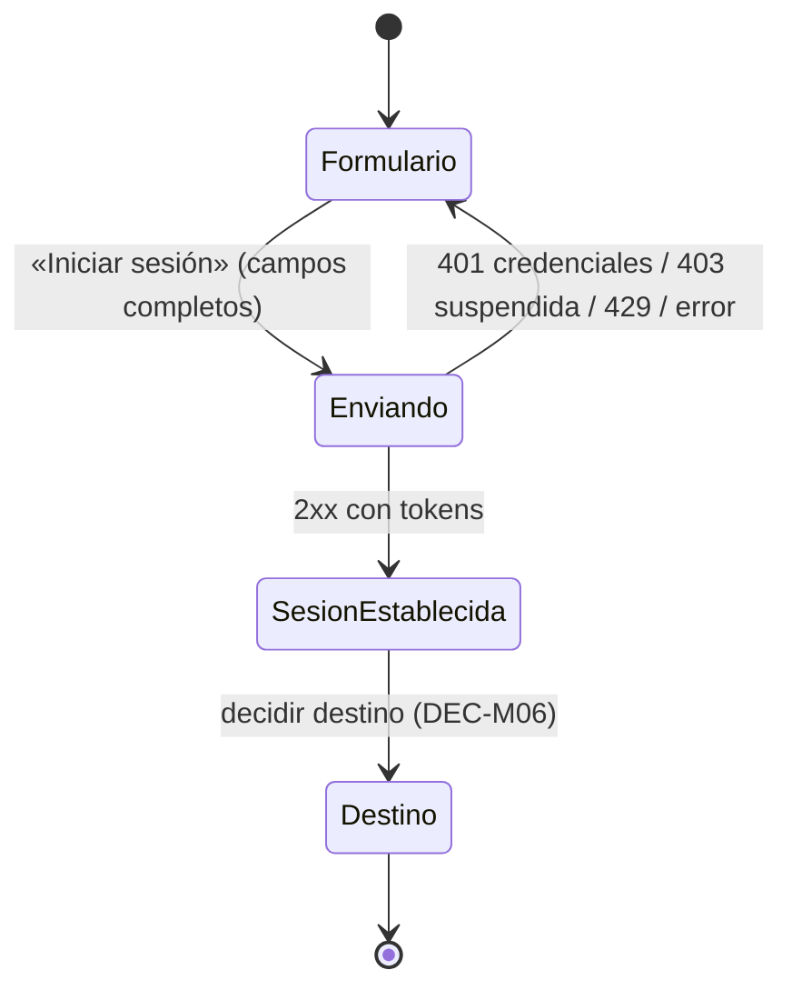

# F02 — Inicio de sesión (cliente móvil)

**Versión:** 0.1.0 | **Estado:** Propuesto — requiere aprobación | **Origen:** backend `M01 Identidad, autenticación y cuenta` | **HU:** HU-004 | **Endpoints del backend:** `EP-M01-04` (login), `EP-M01-08` (renovación de sesión, sin HU directa) (Propuesto, backend) | **Dependencias:** F01, `ARQM-002`, `ARQM-003`, `ARQM-004`, `ARQM-005`, ADR-M002 | **Bloqueos:** DEC-M06, DEC-M09, ALN-02, ALN-03.

> **Regla de este documento (CM-16):** las columnas **URL** están **en blanco a propósito**. Los JSON usan valores **ficticios** (correo `.invalid`, tokens como marcador). El backend sí define `LoginResponse` (`accessToken`, `refreshToken`, `expiraEn`); el resto se marca **Propuesto — por acordar**.

## Contexto y resultado observable
Una persona con cuenta confirmada ingresa **correo y contraseña** en un **único formulario** (el mismo para cualquier cuenta, incluida la administrativa) y obtiene una sesión que **permanece viva** hasta que cierre sesión (lineamiento 16). No hay código de verificación adicional ni elección de rol.

## HU vinculada (texto literal del backend)

| HU | Sprint | RF | Texto |
|---|---|---|---|
| HU-004 | Sprint 1 | RF-02 | Iniciar sesión con mi correo y contraseña en un solo formulario, sin código adicional ni elegir un rol; al entrar, abrir Explorar (mapa); si la cuenta es de administrador, abrir Expedientes |

## Alcance
**Incluye:** formulario de inicio de sesión; envío; manejo de errores (credenciales inválidas, cuenta suspendida, límite de uso); establecimiento y **restauración** de la sesión (renovación silenciosa) según `ARQM-003`; enlaces desde el formulario hacia registro (F01) y «¿Olvidaste tu contraseña?» (destino definido por una funcionalidad futura).
**No incluye:** cierre de sesión como pantalla (HU-005; la limpieza de sesión está en `ARQM-003`), recuperación de contraseña (HU-006), perfil, y la pantalla destino (Explorar/Expedientes) — solo la regla de **a dónde navegar** cuando se defina (DEC-M06).

## Flujo (comportamiento)



## Campos y validaciones del cliente (solo de experiencia)

| Campo (UI) | Campo del contrato | Tipo | Oblig. | Validación del cliente |
|---|---|---|---|---|
| Correo electrónico | `correo` | texto | Sí | No vacío y con formato de correo; se envía en minúsculas |
| Contraseña | `contrasena` | texto | Sí | No vacía; **no** se aplica regla de longitud (la decide el servidor); oculta con mostrar/ocultar |

El cliente **no valida la política de contraseña** del registro al iniciar sesión, para no revelar reglas ni divergir del servidor.

## Contrato con el backend

### F02-C1 · Iniciar sesión — `EP-M01-04` (HU-004)

| Campo | Contenido |
|---|---|
| Método | `POST` |
| **URL** | **`                                                  `** *(en blanco — completar)* |
| Autenticación | Público |
| Reintentos del cliente | **Ninguno automático** (consume intentos limitados por el servidor); acción deshabilitada mientras está pendiente |
| Estado del contrato | Solicitud y `LoginResponse`: **Propuesto (backend)**; errores 403 y cuenta sin confirmar: **por acordar** (ALN-03) |

**Solicitud (JSON de ejemplo, valores ficticios):**
```json
{
  "correo": "persona@ejemplo.invalid",
  "contrasena": "<contraseña de la cuenta>"
}
```

**Respuesta exitosa — `LoginResponse` (campos definidos por el backend; valores ficticios):**
```json
{
  "accessToken": "<token de acceso de corta vida>",
  "refreshToken": "<token de renovación>",
  "expiraEn": "2026-01-01T01:00:00Z"
}
```
*El cliente usa `expiraEn` (UTC) como única fuente de vigencia; no codifica duraciones (ALN-08). El `LoginResponse` **no** trae rol ni destino (ALN-02, DEC-M06).*

**Errores (`ProblemDetails`):**

| HTTP | Caso | JSON de ejemplo | Estado de interfaz |
|---|---|---|---|
| 400 | Datos mal formados | `{"type":"<tipo>","title":"Datos inválidos","status":400,"traceId":"<id>","errors":{"correo":["<mensaje>"]}}` | `error` por campo |
| 401 | Credenciales inválidas | `{"type":"<tipo>","title":"<título>","status":401,"traceId":"<id>"}` | `error` genérico: **«Revisa tu correo y contraseña»** |
| 403 | Cuenta suspendida | `{"type":"<tipo>","title":"<título>","status":403,"traceId":"<id>"}` | `prohibido` con mensaje neutro (ver MV-F02-R04) |
| 403/otro | Cuenta **sin confirmar** | **Por acordar** (DEC-M09, ALN-03) | Reanudar confirmación sin revelar existencia |
| 429 | Límite de uso | `{"type":"<tipo>","title":"<título>","status":429,"traceId":"<id>"}` + `Retry-After` si existe | `limiteDeUso` |
| 5xx / red | Fallo | `{"type":"<tipo>","title":"<título>","status":500,"traceId":"<id>"}` | `error` / `sinConexion` |

### F02-C2 · Renovar sesión — `EP-M01-08` (soporte de la sesión viva; sin HU directa)

| Campo | Contenido |
|---|---|
| Método | `POST` |
| **URL** | **`                                                  `** *(en blanco — completar)* |
| Autenticación | Público (el refresh token viaja en la solicitud) |
| Quién lo llama | Solo la capa de sesión (`ARQM-003`), nunca una pantalla |
| Estado del contrato | `RefreshRequest` sin campos definidos en el backend → **Propuesto — por acordar**; respuesta = `LoginResponse` |

**Solicitud (JSON propuesto — por acordar):**
```json
{
  "refreshToken": "<token de renovación vigente>"
}
```
**Respuesta exitosa:** igual a `LoginResponse` (tokens nuevos; el refresh anterior queda inservible por rotación).
**Errores:** `401` refresh revocado, vencido o reutilizado → cierre de sesión local (`ARQM-003`, MV-A03-R07); `429` → `limiteDeUso`.

## Reglas específicas del cliente

| ID | Requisito (DEBE) | Origen |
|---|---|---|
| MV-F02-R01 | Un **único formulario** (correo y contraseña) para cualquier cuenta; sin código adicional ni selección de rol; la cuenta administrativa usa el mismo formulario | HU-004 |
| MV-F02-R02 | Un 2xx establece la sesión: el refresh token va a almacenamiento seguro y el access token según ADR-M002 (Propuesto: en memoria); el estado pasa a `ConSesion` | ARQM-003, ADR-M002 |
| MV-F02-R03 | Un 401 en login muestra siempre **«Revisa tu correo y contraseña»**, idéntico para correo inexistente o contraseña errónea, sin indicar cuál dato falló | HU-004, CM-07 |
| MV-F02-R04 | Un 403 por cuenta suspendida muestra un mensaje **neutro** que no confirma datos adicionales; el texto exacto lo define el catálogo tras revisión de seguridad (el backend lo distingue del 401, lo que debe revisarse por enumeración) | CM-07, ALN-03 |
| MV-F02-R05 | Un 429 muestra `limiteDeUso`, respeta `Retry-After`, **no reintenta** automáticamente y deshabilita la acción durante la espera | ARQM-004 |
| MV-F02-R06 | La contraseña solo vive en memoria del formulario, se vacía al enviar con éxito o al salir, y nunca se registra ni persiste | CM-07 |
| MV-F02-R07 | Al abrir la app con credencial guardada, el cliente **restaura** la sesión con una renovación única antes de mostrar contenido protegido; si falla (401), pasa a `SinSesion` mostrando el formulario | Lineamiento 16, ARQM-003 |
| MV-F02-R08 | El **destino tras el login** (Explorar o Expedientes) se decide con el dato que el backend defina (DEC-M06); **hasta entonces el cliente no deduce el rol** ni navega por suposición | HU-004, ALN-02 |
| MV-F02-R09 | La cuenta sin confirmar se maneja según DEC-M09: el cliente podrá reanudar la confirmación (F01) sin revelar si la cuenta existe; **no se implementa** hasta acordar el contrato | DEC-M09 |
| MV-F02-R10 | El formulario ofrece enlaces a registro (F01) y a «¿Olvidaste tu contraseña?»; el destino del segundo lo define la funcionalidad de recuperación (no autorizada aún), por lo que el enlace permanece **inactivo/no definido** en esta spec | Maqueta, CM-02 |
| MV-F02-R11 | El envío deshabilita la acción y muestra progreso (sin doble envío); ante error se conserva el correo y se vacía la contraseña | ARQM-005 |
| MV-F02-R12 | Todo control tiene etiqueta accesible; los errores se anuncian a lectores de pantalla; el foco va al campo con error | ARQM-005 |
| MV-F02-R13 | El inicio de sesión no pide permisos del dispositivo ni habilita biometría (no solicitada); el registro del dispositivo para notificaciones se especificará aparte | CM-02, MV-A02-R10 |

## Criterios de aceptación (Gherkin; los de backend se conservan sin reinterpretar)

### HU-004 — Iniciar sesión sin rol ni código
```gherkin
Escenario: Inicio de sesión exitoso sin elegir rol
  Dado que tengo una cuenta confirmada con correo "persona@ejemplo.invalid"
  Cuando inicio sesión con el correo y la contraseña correctos
  Entonces el sistema me autentica sin pedir un código adicional ni que elija un rol
  Y se emite un token de acceso y un token de renovación

Escenario: Credenciales inválidas con mensaje genérico
  Dado que escribo un correo o una contraseña incorrectos
  Cuando intento iniciar sesión
  Entonces el sistema responde "Revisa tu correo y contraseña" sin indicar cuál dato falló

Escenario: Cuenta de administrador usa el mismo formulario
  Dado que mi cuenta es de administrador
  Cuando inicio sesión con el mismo formulario
  Entonces se abre Expedientes en lugar de Explorar
  # Bloqueado por DEC-M06: el cliente aún no tiene un dato contractual para decidir el destino

Escenario: Cuenta suspendida
  Dado que mi cuenta está suspendida
  Cuando intento iniciar sesión con credenciales correctas
  Entonces el sistema rechaza el acceso con un mensaje neutro

Escenario: Límite de uso (cliente)
  Dado que el servidor responde límite de uso
  Cuando intento iniciar sesión de nuevo
  Entonces la app deshabilita la acción durante la espera indicada y no reintenta sola

Escenario: Restauración de sesión (cliente)
  Dado que inicié sesión antes y no cerré sesión
  Cuando abro la app de nuevo
  Entonces la app renueva la sesión una sola vez y me lleva a mi destino sin pedir credenciales

Escenario: Sesión irrecuperable (cliente)
  Dado que mi token de renovación fue revocado
  Cuando la app intenta renovar la sesión
  Entonces la app limpia mi sesión local y muestra el formulario de inicio de sesión
```

## Referencias a pruebas
`tests/unitarias/UT-F02.md`, `tests/integracion/IT-F02.md`, `tests/seguridad/ST-F02.md`.

## Exclusiones / preguntas abiertas
- **Bloqueantes de G-M07:** DEC-M06 (destino y detección de administrador), DEC-M09 (cuenta sin confirmar), `RefreshRequest` (ALN-01 relacionado), texto del 403.
- Revisión de seguridad: el 403 distinto del 401 puede revelar existencia de la cuenta cuando las credenciales son correctas; el backend debe confirmar que solo ocurre tras validar la contraseña.
- Cierre de sesión, recuperación y perfil: sin spec autorizada.

## Aprobación
- [ ] Product Owner valida HU-004 y los mensajes.
- [ ] Responsable técnico valida contrato, plan y pruebas; backend confirma DEC-M06/DEC-M09 (G-M07).
- [ ] Revisor de seguridad valida antienumeración, 403 y manejo de tokens.
